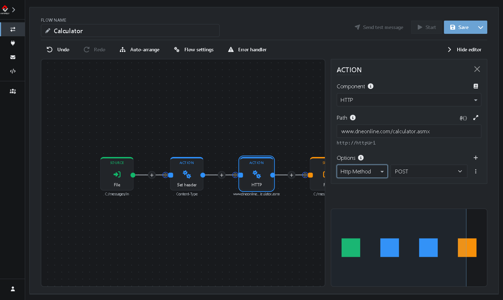
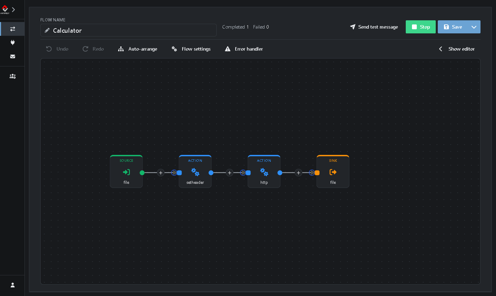

# Tutorial 2: Request/Reply

In this tutorial you build a Flow that calls a web service and saves its reply. You send a sum to a public calculator service and get the answer back as a file.

**What you'll do:**

1. Clone a Flow
2. Add two Actions: one that sets a header and one that calls a web service
3. Send a request and read the reply

It takes about 10 minutes.

## Before you start

* Complete [Tutorial 1](https://github.com/assimbly/gateway/wiki/tutorial6-debugging-a-flow), at least part 1. You need the Gateway running and the *TestFlow* that moves files from `C:/messages/in` to `C:/messages/out`.
* The Gateway needs internet access. The Flow calls the calculator service at `www.dneonline.com`.

> On Linux or macOS, use `/home/<you>/messages/...` wherever this tutorial says `C:/messages/...`.

## How request/reply works

So far your Flows only moved messages from a Source to a Sink. In a request/reply Flow, an Action in the middle sends the message to another system and waits for the answer. The answer replaces the message, so the Sink saves the reply instead of the original request.

The Flow you build looks like this:

**File (Source)** → **Set header (Action)** → **HTTP (Action)** → **File (Sink)**

## Step 1: Clone the TestFlow

1. Go to **Flows → Manage**.
2. In the row of *TestFlow*, click **⋮** (*More actions*) and choose **Clone**. (You did the same in [Tutorial 1](https://github.com/assimbly/gateway/wiki/tutorial6-debugging-a-flow).)
3. Next to **Flow name**, type `Calculator`.

> **Tip:** Need more room on the canvas? Click **<** at the top of the menu on the left to collapse it.

## Step 2: Add an Action that sets a header

The calculator is a SOAP web service. It only accepts a request when the `Content-Type` header says the message is XML. Add an Action that sets this header:

1. Click the **+** on the line between the Source and the Sink.
2. Make sure **Action** is selected, and type `header` in the search box.
3. Choose **Set header**.


The Action appears between the Source and the Sink, and its settings open on the right:

4. Set **Path** (the name of the header) to `Content-Type`.
5. Under **Options**, the rows **language** and **Value** are already there. Type `text/xml` next to **Value**.


## Step 3: Add an Action that calls the web service

1. Click the **+** on the line between the *Set header* Action and the Sink.
2. Type `http` in the search box and choose **HTTP**.
3. Set **Path** to `www.dneonline.com/calculator.asmx`.
4. Under **Options**, choose **Http Method** in the list and select **POST**.



5. Click **Save**.

## Step 4: Send a request

1. Make sure *TestFlow* is stopped (see **Flows → Manage**). If it runs, it picks up the file before *Calculator* can.
2. In the editor of *Calculator*, click **Start**.
3. Create a file `calculator.xml` with this content. It asks the service to add 2 and 2:

   ```xml
   <soapenv:Envelope xmlns:soapenv="http://schemas.xmlsoap.org/soap/envelope/" xmlns:tem="http://tempuri.org/">
      <soapenv:Header/>
      <soapenv:Body>
         <tem:Add>
            <tem:intA>2</tem:intA>
            <tem:intB>2</tem:intB>
         </tem:Add>
      </soapenv:Body>
   </soapenv:Envelope>
   ```

4. Save the file in the `C:\messages\in` folder.

Within a few seconds the **Completed** counter in the editor header goes up:



## Step 5: Read the reply

Open `calculator.xml` in the `C:\messages\out` folder. It no longer contains your request, but the reply of the calculator service (formatted here to make it easier to read):

```xml
<?xml version="1.0" encoding="utf-8"?>
<soap:Envelope xmlns:soap="http://schemas.xmlsoap.org/soap/envelope/" xmlns:xsi="http://www.w3.org/2001/XMLSchema-instance" xmlns:xsd="http://www.w3.org/2001/XMLSchema">
   <soap:Body>
      <AddResponse xmlns="http://tempuri.org/">
         <AddResult>4</AddResult>
      </AddResponse>
   </soap:Body>
</soap:Envelope>
```

The answer is in `<AddResult>`: 2 + 2 = 4. (In case you didn't know already 🙂)

Try it again with other numbers. Or change `Add` into `Multiply`, `Subtract` or `Divide`, both in the opening and the closing tag.

> **No reply?** The calculator is a free public service and sometimes it's slow. If the **Failed** counter goes up instead, click the **Alert** badge. A message like `Connect to http://www.dneonline.com:80 failed: Connection timed out` means the service didn't answer in time. Put the file in the `in` folder again to retry. See [Tutorial 1](https://github.com/assimbly/gateway/wiki/tutorial6-debugging-a-flow) for more on finding errors.

When you're done, stop *Calculator* with **Stop**.

## Summary

| Step | Component | What it does |
|------|-----------|--------------|
| Source | **File** | Picks up the request from the `in` folder. |
| Action | **Set header** | Sets the header `Content-Type: text/xml`, so the service knows the message is XML. |
| Action | **HTTP** | Sends the message to the web service with a POST and waits for the reply. The reply becomes the new message. |
| Sink | **File** | Saves the reply in the `out` folder. |

**Done!** You built your first request/reply Flow. Continue with [Tutorial 3: Calling a REST API](https://github.com/assimbly/gateway/wiki/tutorial6-calling-a-rest-api).
