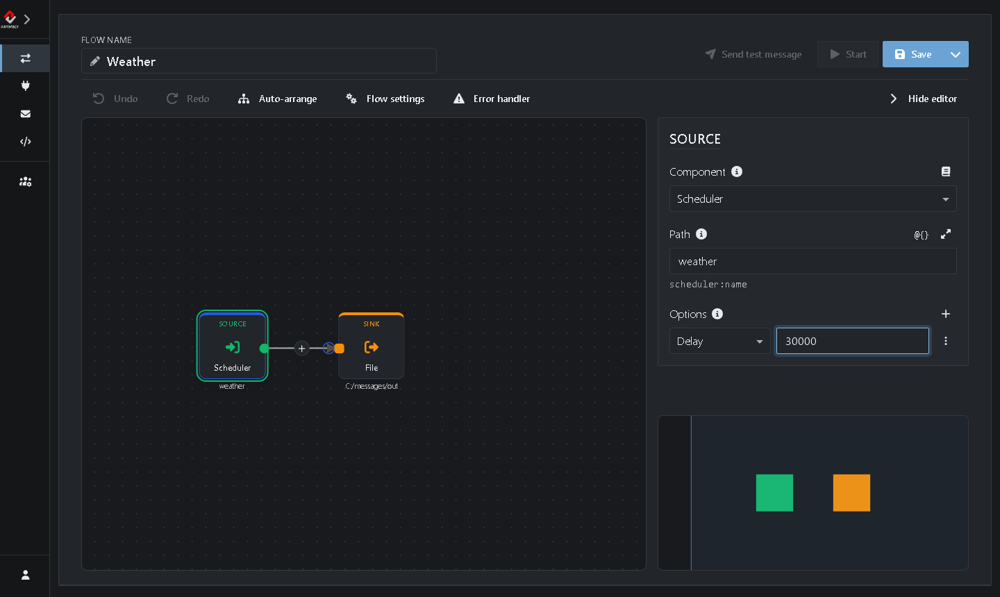
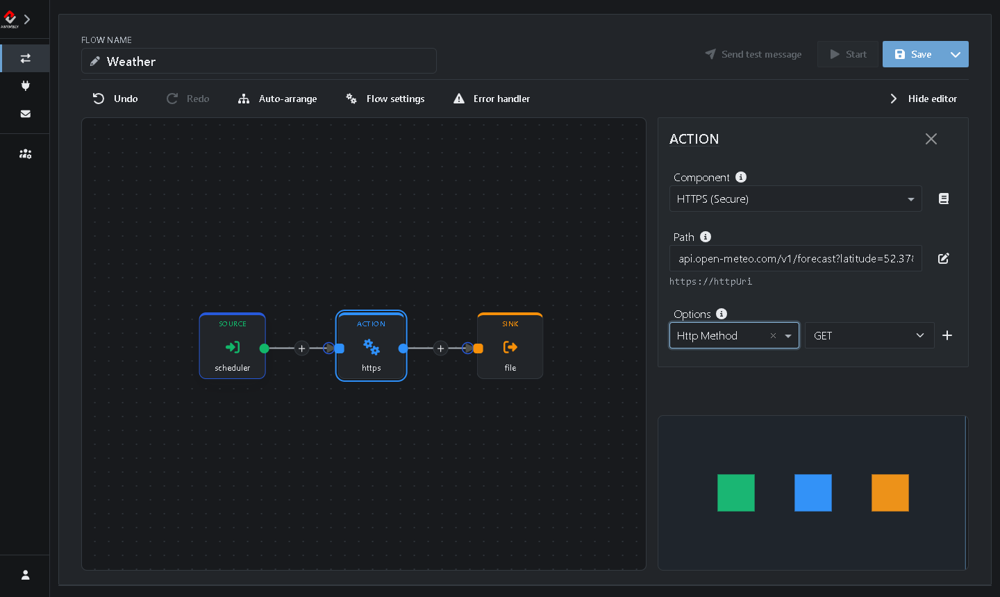
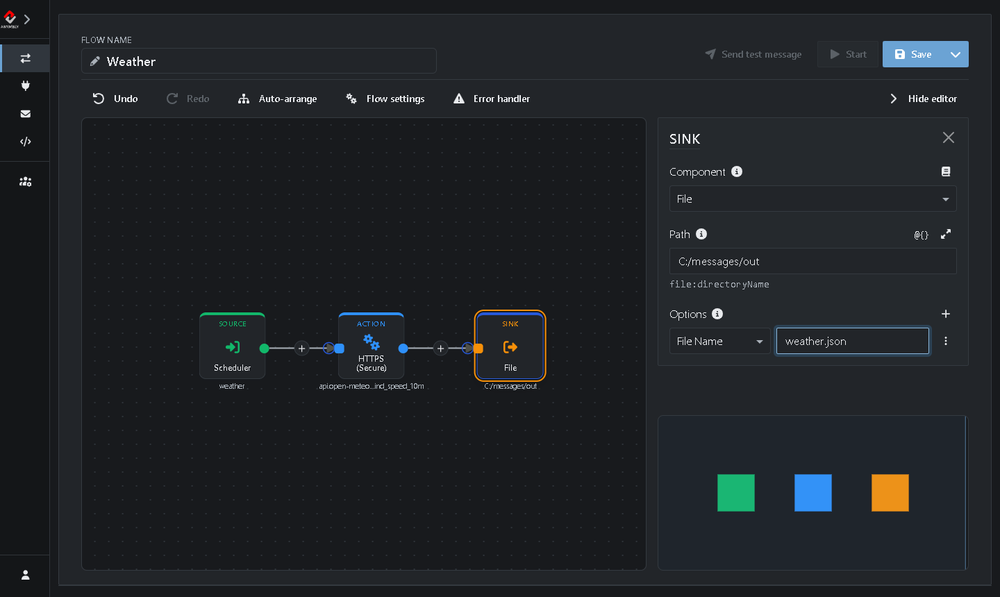
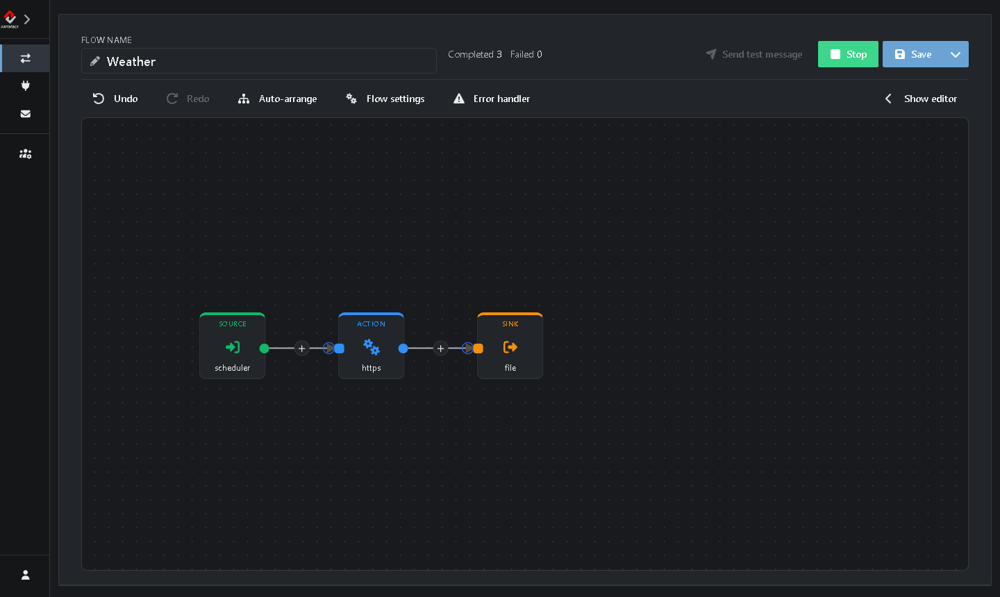

# Tutorial 3: Calling a REST API

In this tutorial you build a Flow that calls a REST API on a schedule. Every minute it asks a free weather service for the current weather in Amsterdam and saves the answer as a JSON file.

**What you'll do:**

1. Clone a Flow
2. Replace the File Source with a Scheduler
3. Add an Action that calls the REST API
4. Give the saved file a fixed name
5. Start the Flow and read the weather

It takes about 10 minutes.

## Before you start

* Complete [Tutorial 1](https://github.com/assimbly/gateway/wiki/tutorial6-debugging-a-flow), at least part 1. You need the Gateway running and the *TestFlow* that moves files from `C:/messages/in` to `C:/messages/out`.
* The Gateway needs internet access. The Flow calls the [Open-Meteo](https://open-meteo.com/) weather API, which is free and needs no account or API key.

> On Linux or macOS, use `/home/<you>/messages/...` wherever this tutorial says `C:/messages/...`.

## How it works

In [Tutorial 2](https://github.com/assimbly/gateway/wiki/tutorial6-request-reply) a file started the Flow. A REST API call that fetches data doesn't need a file, it only needs a trigger. That's what a **Scheduler** Source does: it starts the Flow at a fixed interval with an empty message.

The Flow you build looks like this:

**Scheduler (Source)** → **HTTPS (Action)** → **File (Sink)**

## Step 1: Clone the TestFlow

1. Go to **Flows → Manage**.
2. In the row of *TestFlow*, click **⋮** (*More actions*) and choose **Clone**.
3. Next to **Flow name**, type `Weather`.

## Step 2: Use a Scheduler as Source

1. Click the **Source** on the canvas. Its settings open on the right. (Don't see them? Click **Show editor**.)
2. Click **Component**, type `sched` and choose **Scheduler**.
3. Set **Path** to `weather`. This is just a name for the scheduler; any name will do.
4. Under **Options**, choose **Delay** in the list and type `60000`.



The delay is in milliseconds, so the Flow runs once every minute. The first run starts a second after you start the Flow.

## Step 3: Call the REST API

1. Click the **+** on the line between the Source and the Sink.
2. Type `https` in the search box and choose **HTTPS (Secure)**.
3. Set **Path** to:

   ```
   api.open-meteo.com/v1/forecast?latitude=52.37&longitude=4.89&current=temperature_2m,wind_speed_10m
   ```

   This asks for the current temperature and wind speed at latitude 52.37, longitude 4.89: the center of Amsterdam.

4. Under **Options**, choose **Http Method** in the list and select **GET**.



> **HTTP or HTTPS?** Choose the component that matches the address of the API. Open-Meteo uses `https://`, so you choose **HTTPS (Secure)**. You type the address without `https://`, as the hint under **Path** shows.

## Step 4: Give the saved file a fixed name

The Sink saves each reply as a new file with a generated name. Give it a fixed name, so you always know where to look:

1. Click the **Sink** on the canvas.
2. Under **Options**, choose **File Name** in the list and type `weather.json`.



3. Click **Save**.

## Step 5: Start the Flow and read the weather

1. Click **Start**.

After a second the Flow makes its first call, and the **Completed** counter goes up:



2. Open `weather.json` in the `C:\messages\out` folder. It contains the answer of the API, for example (shortened and formatted here to make it easier to read):

```json
{
  "latitude": 52.366,
  "longitude": 4.901,
  "timezone": "GMT",
  "current_units": {
    "time": "iso8601",
    "interval": "seconds",
    "temperature_2m": "°C",
    "wind_speed_10m": "km/h"
  },
  "current": {
    "time": "2026-10-15T13:00",
    "interval": 900,
    "temperature_2m": 18.5,
    "wind_speed_10m": 18.7
  }
}
```

Every minute the Flow calls the API again and overwrites `weather.json` with the latest weather.

**Try it yourself:**

* Get the weather of your own town: change `latitude` and `longitude` in the **Path** of the HTTPS Action. Save the Flow, then click **Stop** and **Start** to run it with the new settings.
* Add `relative_humidity_2m` to the list after `current=` to get the humidity as well.

When you're done, click **Stop**. Otherwise the Flow keeps calling the API every minute.

> **No file?** Click the **Alert** badge in the editor header to see the error. See [Tutorial 1](https://github.com/assimbly/gateway/wiki/tutorial6-debugging-a-flow) for more on finding errors.
>
> **`the trustAnchors parameter must be non-empty`?** A new Gateway doesn't trust any HTTPS site yet. Go to **Administration → Certificates**, click **Add → Download certificate**, type `https://api.open-meteo.com` under **Url** and click **Add**. Then click **Stop** and **Start** on the Flow.

## Summary

| Step | Component | What it does |
|------|-----------|--------------|
| Source | **Scheduler** | Starts the Flow every 60 seconds (**Delay** `60000`). |
| Action | **HTTPS** | Calls the REST API with a GET. The answer of the API becomes the message. |
| Sink | **File** | Saves the answer as `weather.json` (**File Name**) in the `out` folder. |

**Done!** You called your first REST API. In the next tutorial you turn things around and create a REST API yourself: [Tutorial 4: Creating a REST API](https://github.com/assimbly/gateway/wiki/tutorial6-creating-a-rest-api).
