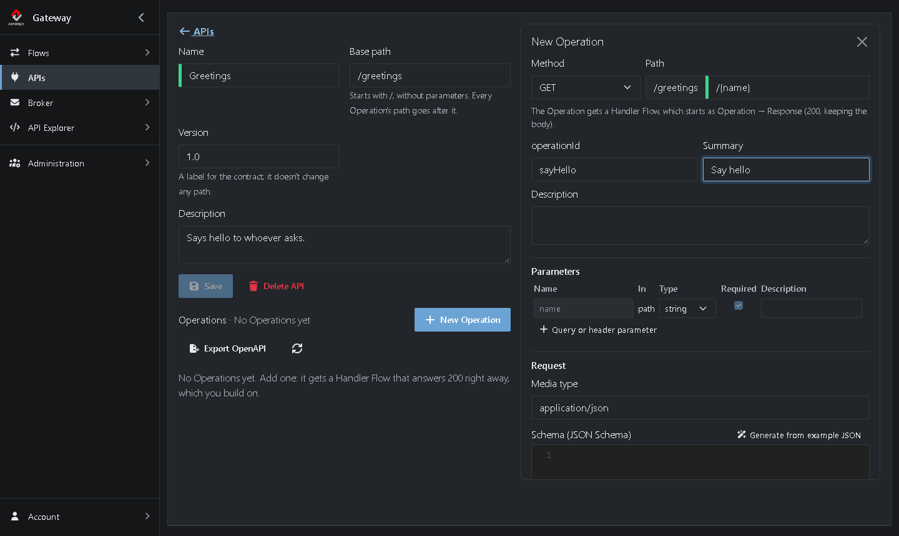
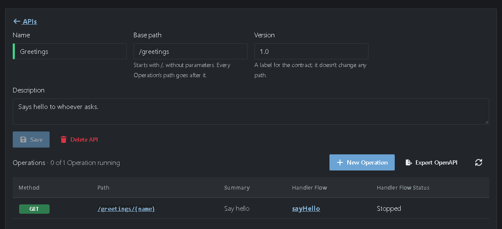
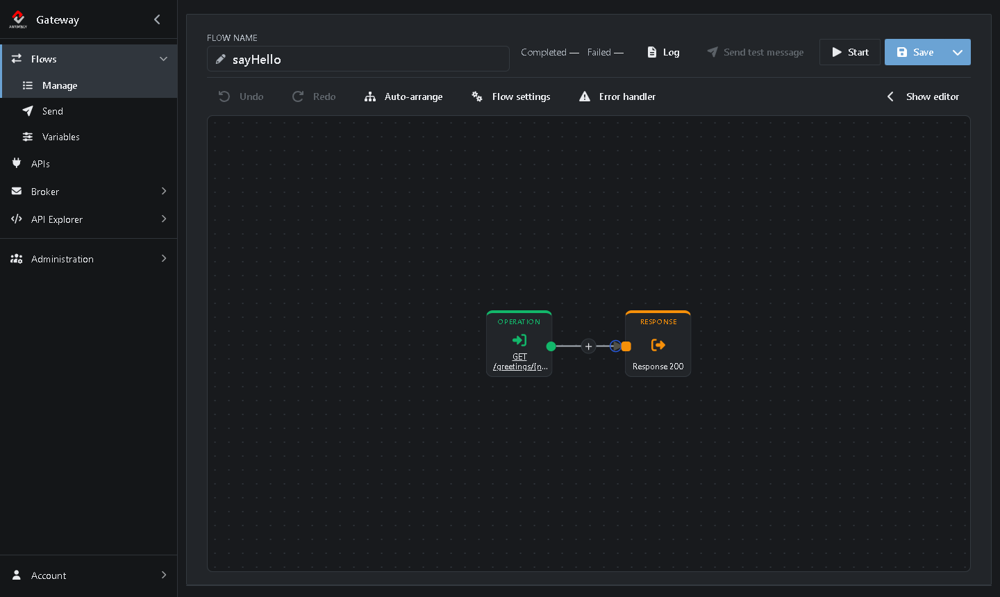
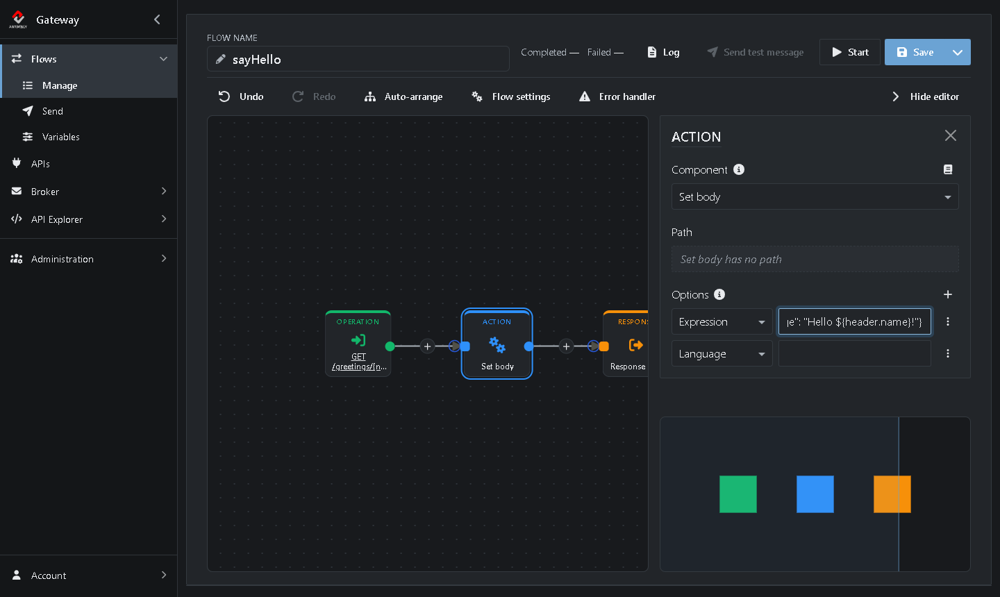

# Tutorial 4: Creating a REST API

In [Tutorial 3](https://github.com/assimbly/gateway/wiki/tutorial6-calling-a-rest-api) the Gateway called someone else's API. In this tutorial you turn things around: you create a REST API that others can call. It says hello to whoever calls it.

**What you'll do:**

1. Create an API
2. Add an Operation
3. Build the Handler Flow that answers it
4. Call your API
5. Export the API as an OpenAPI file

It takes about 10 minutes.

## Before you start

* Complete the [Quick start](https://github.com/assimbly/gateway/wiki/quick-start). You only need the Gateway running; this tutorial doesn't use files.

## How it works

The **APIs** page lets you design a REST API the same way you would write an [OpenAPI](https://www.openapis.org/) contract:

| Term | Meaning |
|------|---------|
| **API** | A group of Operations under one base path, for example `/greetings`. |
| **Operation** | One method plus path that clients can call, for example `GET /greetings/{name}`. |
| **Handler Flow** | The Flow that answers an Operation. The Gateway creates it for you when you add the Operation. |

## Step 1: Create the API

1. Click **APIs** in the menu on the left.
2. Click **Add**.
3. Fill in the form:
   * **Name:** `Greetings`
   * **Base path:** `/greetings` (the field already starts with `/`, so type `greetings` after it)
   * **Version:** keep `1.0`
   * **Description:** `Says hello to whoever asks.`


4. Click **Create API**.

## Step 2: Add an Operation

1. Click **New Operation**. A panel opens on the right.
2. Keep **Method** on `GET`.
3. **Path** already shows `/greetings` and `/`. Type `{name}` after the `/`, so it reads `/{name}`. The part between curly braces is a *path parameter*. It appears under **Parameters** by itself.
4. Set **operationId** to `sayHello` and **Summary** to `Say hello`.



5. Click **Add Operation**.

The Operation appears in the list, together with its Handler Flow, *sayHello*. The flow is stopped for now:



## Step 3: Build the Handler Flow

1. Click **sayHello** in the **Handler Flow** column. The Flow editor opens.

The Gateway already built the Flow for you. It has two Steps: the **Operation** that receives the request and the **Response** that sends the answer, with HTTP status 200:



Right now the Flow would answer with an empty message. Add an Action that writes the answer:

2. Click the **+** on the line between the Operation and the Response.
3. Type `body` in the search box and choose **Set body**.
4. Under **Options**, the rows **Expression** and **Language** are already there. Next to **Expression**, type:

   ```
   {"message": "Hello ${header.name}!"}
   ```



5. Click **Save**, then **Start**.

> **What does `${header.name}` do?** The Gateway puts every path parameter in a header with the same name. `${header.name}` is an expression in Camel's [Simple language](https://camel.apache.org/components/latest/languages/simple-language.html) that reads that header. Set body evaluates its expression with Simple by default, so leave **Language** empty. To send the text exactly as typed, set **Language** to `constant`.

> **Longer expressions?** Click **⋮** at the end of the **Expression** row to write it in a larger editor. A Set body has no path, so its **Path** field is read-only.

## Step 4: Call your API

Go back to the API (click **APIs**, then **Greetings**). It now says **1 of 1 Operation running**:


The Gateway serves your APIs over HTTPS on port `9001`. Call it with your own name:

**Windows (PowerShell)**

```powershell
curl.exe -k https://localhost:9001/greetings/World
```

**Linux / macOS**

```bash
curl -k https://localhost:9001/greetings/World
```

The answer:

```json
{"message": "Hello World!"}
```

> **Why `-k`?** A Gateway on your own machine uses a certificate that `curl` doesn't trust. `-k` tells it to accept the certificate anyway. You can also open `https://localhost:9001/greetings/World` in your browser and accept the warning.
>
> **No answer at all?** If `curl` says the TLS handshake failed, the Gateway has no certificate of its own yet. Go to **Administration → Certificates**, click **Add → Self-signed identity**, type `localhost` under **Common Name (CN)** and click **Generate**. Then call the API again; you don't need to restart anything.

## Step 5: Export the API as an OpenAPI file

Want to share your API with the people who will call it? Give them the contract:

1. On the API page, click **Export OpenAPI**.
2. Choose **Export as YAML** (or **Export as JSON**).

You get a file `Greetings-openapi.yaml` that starts like this:

```yaml
openapi: 3.0.3
info:
  title: Greetings
  version: "1.0"
  description: Says hello to whoever asks.
servers:
- url: https://localhost:9001/greetings
paths:
  /{name}:
    get:
      operationId: sayHello
      summary: Say hello
      parameters:
      - name: name
        in: path
        required: true
        schema:
          type: string
```

Tools such as Postman, Insomnia or Swagger UI can import this file. It also works the other way around: with **Import** on the **APIs** page you create an API from an existing OpenAPI file.

When you're done, stop the *sayHello* Flow with **Stop** in its editor.

## Summary

| What | Where | What it does |
|------|-------|--------------|
| API *Greetings* | **APIs → Add** | Groups the Operations under the base path `/greetings`. |
| Operation `GET /{name}` | **New Operation** | Defines what clients can call. Creates the Handler Flow. |
| Handler Flow *sayHello* | Flow editor | **Operation** receives the request, **Set body** writes the answer, **Response** sends it back with status 200. |

**Done!** You created your first REST API. Continue with [Tutorial 5: Manage the broker](https://github.com/assimbly/gateway/wiki/tutorial6-manage-the-broker).
