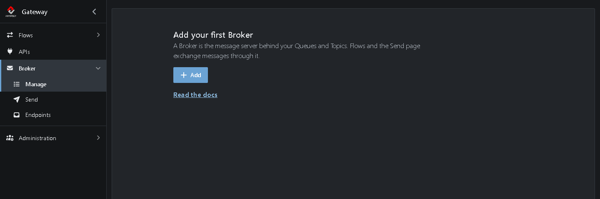
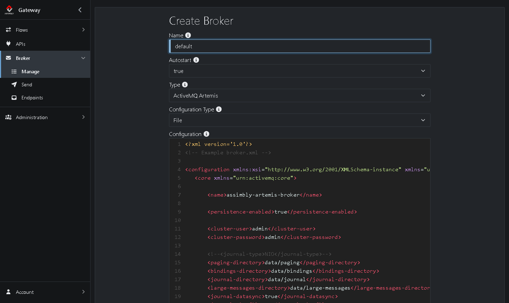

# Tutorial 5: Create a new broker

The Gateway has a message broker built in. In this tutorial you get to know it: you create a broker, add a queue, send a message to it and read the message back.

**What you'll do:**

1. Look at the broker that comes with the Gateway
2. Remove it and create a new one
3. Create a queue
4. Send a message to the queue
5. Browse the message

It takes about 10 minutes.

## Before you start

* Complete the [Quick start](https://github.com/assimbly/gateway/wiki/quick-start). You only need the Gateway running.
* Use a Gateway you're trying out. In this tutorial you remove the broker and create it again. Don't do that on a Gateway that handles real messages.

## How it works

A **broker** is a message server. Instead of sending a message straight to another system, you put it on the broker, and the broker keeps it until someone picks it up. This way the sender and the receiver don't need to be online at the same time.

| Term | Meaning |
|------|---------|
| **Broker** | The message server. The Gateway runs [Apache ActiveMQ](https://activemq.apache.org/) inside it: either ActiveMQ Artemis or ActiveMQ Classic. |
| **Queue** | A named place on the broker where messages wait. Each message is picked up by exactly one receiver. |
| **Topic** | Like a queue, but every subscriber gets its own copy of each message. |
| **Endpoint** | The Gateway's name for a queue or a topic. |

## Step 1: Look at the broker that comes with the Gateway

Go to **Broker → Manage**. When the Gateway starts for the first time, it creates a broker called *default* for you:

* The green buttons under **Status** show that the broker is running. With them you can **Stop** and **Restart** the broker.
* **Messages** shows how many messages are waiting on the broker, over all its queues.
* Click **Edit** to see its settings, or **⋮** → **Info** for a short summary.

## Step 2: Remove the broker

Suppose you want to start over, or switch to the other type of broker. Then you remove the broker and create a new one:

1. Click **⋮** (*More actions*) in the row of *default* and choose **Delete**.
2. Confirm with **Delete**.

The page is now empty and invites you to add your first broker:

## Step 3: Create a new broker

1. Click **Add**.
2. Fill in the form:
   * **Name:** `default`
   * **Autostart:** `true`. The broker then starts by itself whenever the Gateway starts.
   * **Type:** `ActiveMQ Artemis`. This is the default; choose `ActiveMQ Classic` if you need the older broker.
   * **Configuration Type:** `File`. The broker uses the configuration file shown under **Configuration**.
   * **Configuration:** keep the example. It's a working `broker.xml` for Artemis.

3. Click **Save**.

The broker appears in the list again, with green **Status** buttons: it's running.

> **Embedded or File?** **Embedded** starts a simple broker on localhost without a configuration file. It's handy for a quick test. **File** gives you full control: the **Configuration** field holds the broker file (`broker.xml` for Artemis, `activemq.xml` for Classic). If you leave it empty, the Gateway creates a default file. See the [Artemis](https://activemq.apache.org/components/artemis/documentation/latest/configuration-index.html) or [ActiveMQ Classic](https://activemq.apache.org/components/classic/documentation) documentation for all settings.

## Step 4: Create a queue

1. Go to **Broker → Endpoints**. The **Queues** tab lists the queues on the broker. The example configuration already defines two: `DLQ` (the dead letter queue) and `ExpiryQueue`.
2. Click **Add**.
3. Set **Name** to `HelloQueue`.

4. Click **Save**.

*HelloQueue* now appears in the list, with 0 messages:

## Step 5: Send a message

1. Click **Send** in the row of *HelloQueue*. The **Send** page opens, with *HelloQueue* already filled in as destination.
2. Under **Body**, type `Hello broker!`.

3. Click **Send** at the top right.

A notification confirms: *Message sent to queue HelloQueue*.

> You can also open this page with **Broker → Send**. Choose **Queue** or **Topic** and pick the endpoint from the list. With **Upload** you send the content of a file, and on the **Headers** tab you add headers to the message.

## Step 6: Browse the message

1. Go back to **Broker → Endpoints**. *HelloQueue* now has 1 message.
2. Click **HelloQueue**.

The **Browse Messages** page lists the messages on the queue. On the right you see the body and the headers of the selected message:

Browsing only *looks* at the messages: they stay on the queue until a receiver picks them up. In the [next tutorial](https://github.com/assimbly/gateway/wiki/tutorial6-message-queueing) a Flow will do exactly that.

## Clean up (optional)

Want to remove *HelloQueue*? In **Broker → Endpoints**, click **⋮** in its row and:

1. Choose **Clear** to remove its messages.
2. Choose **Delete** to remove the queue.

## Summary

| What | Where | What it does |
|------|-------|--------------|
| Broker | **Broker → Manage** | The message server. Start, stop, edit or create it here. |
| Queue | **Broker → Endpoints** | A named place where messages wait. Add, browse, clear or delete it here. |
| Send | **Broker → Send** (or **Send** in a queue's row) | Puts a test message on a queue or topic. |
| Browse | Click a queue in **Broker → Endpoints** | Shows the waiting messages, without removing them. |

**Done!** You created a broker and sent your first message through it. Continue with [Tutorial 6: Message Queueing](https://github.com/assimbly/gateway/wiki/tutorial6-message-queueing).
