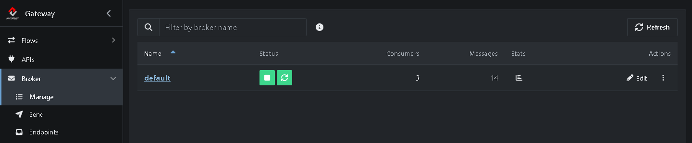
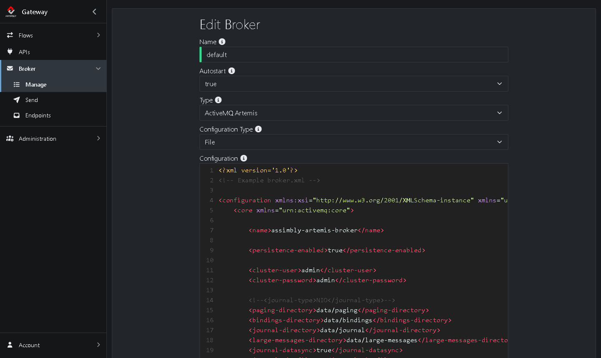
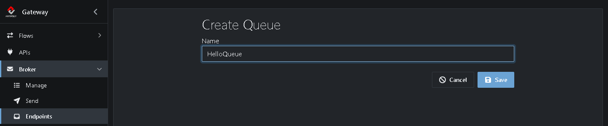
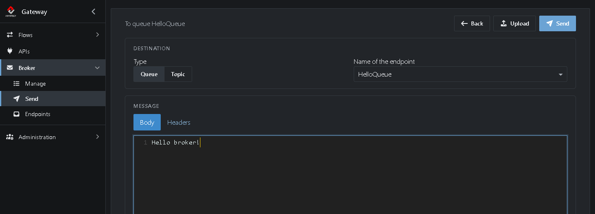

# Tutorial 5: Manage the broker

The Gateway has a message broker built in, and creates one for you the first time it starts. In this tutorial you get to know it: you check that it runs, stop and start it, look at its configuration file, add a queue, send a message to it and read the message back.

**What you'll do:**

1. Look at the broker that comes with the Gateway
2. Stop and start the broker
3. Look at the broker file
4. Create a queue
5. Send a message to the queue
6. Browse the message

It takes about 10 minutes.

## Before you start

* Complete the [Quick start](https://github.com/assimbly/gateway/wiki/quick-start). You only need the Gateway running.
* Use a Gateway you're trying out. In this tutorial you stop the broker for a moment. Don't do that on a Gateway that handles real messages.

## How it works

A **broker** is a message server. Instead of sending a message straight to another system, you put it on the broker, and the broker keeps it until someone picks it up. This way the sender and the receiver don't need to be online at the same time.

| Term | Meaning |
|------|---------|
| **Broker** | The message server. The Gateway runs [Apache ActiveMQ](https://activemq.apache.org/) inside it: either ActiveMQ Artemis or ActiveMQ Classic. |
| **Queue** | A named place on the broker where messages wait. Each message is picked up by exactly one receiver. |
| **Topic** | Like a queue, but every subscriber gets its own copy of each message. |
| **Endpoint** | The Gateway's name for a queue or a topic. |

## Step 1: Look at the broker that comes with the Gateway

Go to **Broker → Manage**. When the Gateway starts for the first time, it creates a broker called *default* for you: an ActiveMQ Artemis broker that starts by itself whenever the Gateway starts.

* The green buttons under **Status** show that the broker is running.
* **Consumers** shows how many receivers are connected, for example running Flows that read from a queue. **Messages** shows how many messages are waiting, over all queues.
* Click the **Stats** icon for details such as the broker version, its uptime and the number of connections:

* Click **⋮** (*More actions*) → **Info** for a short summary of the broker's settings.

## Step 2: Stop and start the broker

1. Click **Stop** (the square) under **Status**.

The broker stops. Only the **Start** button (the triangle) is left, and **Stats** is empty. While the broker is stopped, no one can put messages on it or take them off: Flows that use a queue fail until the broker is back.

2. Click **Start**.

After a few seconds the green buttons are back. The messages that were waiting are still there: the broker keeps them on disk.

> **Restart** (the circular arrows) stops the broker and starts it again in one go. You need it after you change the broker file, as you'll see in the next step.

## Step 3: Look at the broker file

1. Click **Edit** in the row of *default*.

The form shows the broker's settings:

* **Autostart** `true`: the broker starts whenever the Gateway starts.
* **Type** `ActiveMQ Artemis`. The other option is `ActiveMQ Classic`.
* **Configuration Type** `File`: the broker uses the configuration file below.
* **Configuration**: the broker file itself, `broker.xml`. The Gateway keeps it in the `broker` folder of its home folder (`~/.assimbly/broker/broker.xml`).

Some useful parts of the file:

| Element | What it sets |
|---------|--------------|
| `<acceptors>` | The ports clients connect to, for example `61616` for JMS (the port you'll use in [Tutorial 6](https://github.com/assimbly/gateway/wiki/tutorial6-message-queueing)) and `5672` for AMQP. |
| `<address-settings>` | What happens to messages that can't be delivered or expire, for example which dead letter queue they go to. |
| `<addresses>` | Queues that always exist, such as `DLQ` (the dead letter queue) and `ExpiryQueue`. |

To change the broker, edit the file and click **Save**. The Gateway checks that the file is valid before it saves it. The broker reads the file when it starts, so click **Restart** on **Broker → Manage** afterwards. For now, click **Cancel** without changing anything.

> **Embedded or File?** **Embedded** starts a simple broker on localhost without a configuration file. It's handy for a quick test. **File** gives you full control. See the [Artemis](https://activemq.apache.org/components/artemis/documentation/latest/configuration-index.html) or [ActiveMQ Classic](https://activemq.apache.org/components/classic/documentation) documentation for all settings.

## Step 4: Create a queue

1. Go to **Broker → Endpoints**. The **Queues** tab lists the queues on the broker. The broker file already defines two: `DLQ` (the dead letter queue) and `ExpiryQueue`.
2. Click **Add**.
3. Set **Name** to `HelloQueue`.

4. Click **Save**.

*HelloQueue* now appears in the list, with 0 messages:

## Step 5: Send a message

1. Click **Send** in the row of *HelloQueue*. The **Send** page opens, with *HelloQueue* already filled in as destination.
2. Under **Body**, type `Hello broker!`.

3. Click **Send** at the top right.

A notification confirms: *Message sent to queue HelloQueue*.

> You can also open this page with **Broker → Send**. Choose **Queue** or **Topic** and pick the endpoint from the list. With **Upload** you send the content of a file, and on the **Headers** tab you add headers to the message.

## Step 6: Browse the message

1. Go back to **Broker → Endpoints**. *HelloQueue* now has 1 message.
2. Click **HelloQueue**.

The **Browse Messages** page lists the messages on the queue. On the right you see the body and the headers of the selected message:

Browsing only *looks* at the messages: they stay on the queue until a receiver picks them up. In the [next tutorial](https://github.com/assimbly/gateway/wiki/tutorial6-message-queueing) a Flow will do exactly that.

## Clean up (optional)

Want to remove *HelloQueue*? In **Broker → Endpoints**, click **⋮** in its row and choose **Delete**. The queue still holds your message, so the Gateway asks you to confirm: deleting the queue deletes its messages too.

To keep the queue but remove its messages, choose **Clear** instead.

## Summary

| What | Where | What it does |
|------|-------|--------------|
| Broker | **Broker → Manage** | The message server. Start, stop, restart and check it here. |
| Broker file | **Edit** on **Broker → Manage** | The broker's configuration (`broker.xml`). Restart the broker after you change it. |
| Queue | **Broker → Endpoints** | A named place where messages wait. Add, browse, clear or delete it here. |
| Send | **Broker → Send** (or **Send** in a queue's row) | Puts a test message on a queue or topic. |
| Browse | Click a queue in **Broker → Endpoints** | Shows the waiting messages, without removing them. |

**Done!** You know your way around the broker and sent your first message through it. Continue with [Tutorial 6: Message Queueing](https://github.com/assimbly/gateway/wiki/tutorial6-message-queueing).
