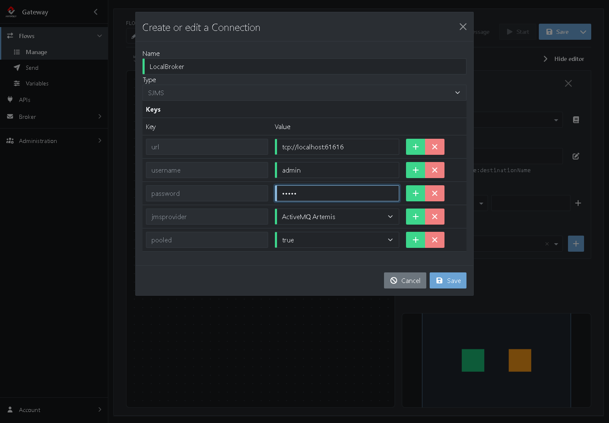
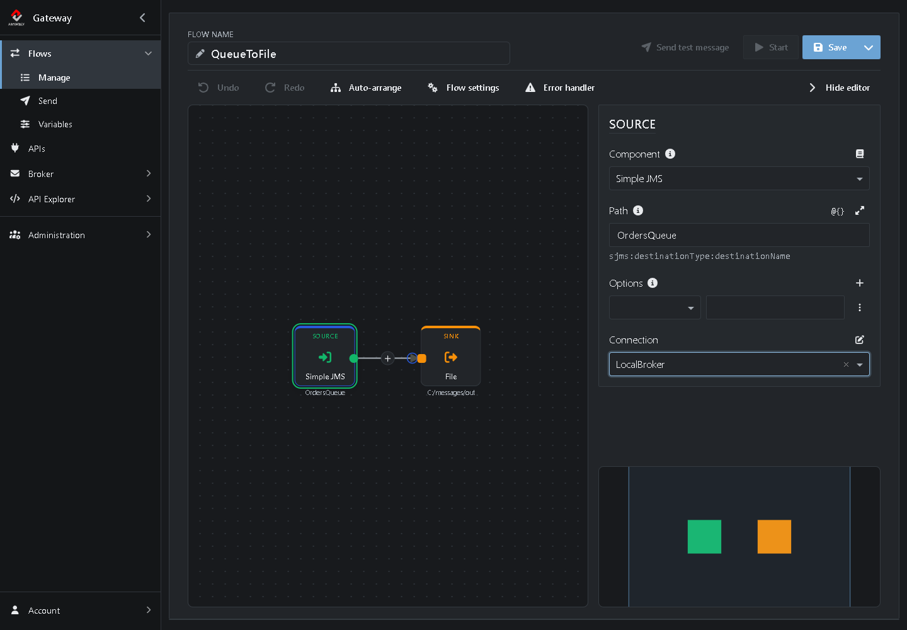
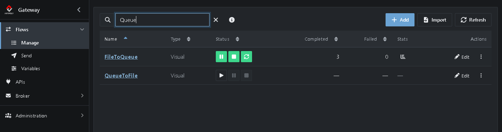
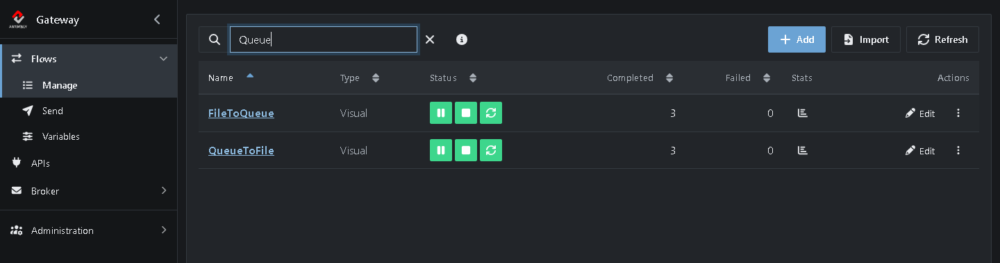
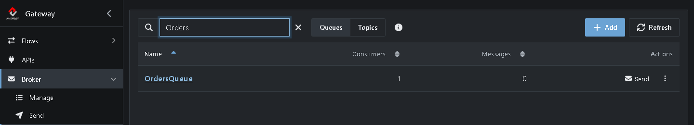

# Tutorial 6: Message Queueing

In this tutorial you put a queue between two Flows. The first Flow puts files on a queue, the second takes them off and writes them to a folder. You'll see the queue's most useful feature: when the receiving side is down, messages wait on the queue until it's back.

**What you'll do:**

1. Build a Flow that puts files on a queue
2. Create a connection to the broker
3. Build a Flow that takes messages off the queue
4. Stop the receiver and watch messages wait on the queue
5. Start the receiver and watch the queue empty

It takes about 15 minutes.

## Before you start

* Complete the [Quick start](https://github.com/assimbly/gateway/wiki/quick-start). You need the Gateway running and the *TestFlow* that moves files from `C:/messages/in` to `C:/messages/out`.
* Do [Tutorial 5](https://github.com/assimbly/gateway/wiki/tutorial6-manage-the-broker) first if you don't know the broker yet. You need a running broker, such as the *default* broker that comes with the Gateway.
* Make sure *TestFlow* is stopped (see **Flows → Manage**). Otherwise it picks up the files before the new Flows can.

> On Linux or macOS, use `/home/<you>/messages/...` wherever this tutorial says `C:/messages/...`.

## How it works

You build two Flows that share one queue, *OrdersQueue*:

**FileToQueue:** **File (Source)** → **Simple JMS (Sink)**, which puts each file on *OrdersQueue*

**QueueToFile:** **Simple JMS (Source)** → **File (Sink)**, which takes each message off *OrdersQueue*

The two Flows don't know about each other. They only know the queue. That's the idea of message queueing: the sender and the receiver are decoupled, and the broker keeps the messages safe in between.

## Step 1: Build the Flow that puts files on the queue

1. Go to **Flows → Manage**, click **⋮** in the row of *TestFlow* and choose **Clone**.
2. Next to **Flow name**, type `FileToQueue`.
3. Click the **Sink** on the canvas.
4. Click **Component**, type `sjms` and choose **Simple JMS**.
5. Set **Path** to `OrdersQueue`. This is the name of the queue.

You don't have to create the queue on the broker first: the broker creates it the first time a Flow uses it.

## Step 2: Create a connection to the broker

A JMS component needs to know which broker to talk to. That's what a **Connection** is for. A new field, **Connection**, appeared at the bottom of the Sink's settings.

1. Click the **+** next to **Connection**. The window *Create or edit a Connection* opens.
2. Fill it in:
   * **Name:** `LocalBroker`
   * **url:** `tcp://localhost:61616`. This is the address of the broker that runs in the Gateway.
   * **username:** `admin`
   * **password:** `admin`
   * **jmsprovider:** `ActiveMQ Artemis`
   * **pooled:** `true`. The connection then reuses a pool of open connections, which is faster.



3. Click **Save**.

The new connection is selected in the **Connection** field:


4. Click **Save** to save the Flow.

> The username and password are those of the broker. If you changed them in the broker's configuration, use your own.

## Step 3: Build the Flow that takes messages off the queue

1. Go back to **Flows → Manage** and clone *TestFlow* once more.
2. Next to **Flow name**, type `QueueToFile`.
3. Click the **Source** on the canvas.
4. Click **Component**, type `sjms` and choose **Simple JMS**.
5. Set **Path** to `OrdersQueue`.
6. Under **Connection**, choose `LocalBroker`. You only create a connection once; after that, every Flow can use it.



7. Click **Save**.

The Sink of this Flow is still the File component of *TestFlow*: it writes to `C:/messages/out`.

## Step 4: Send files while the receiver is down

First start only the sender:

1. Go to **Flows → Manage** and type `Queue` in the filter box.
2. Click **▶** (*Start*) in the row of *FileToQueue*. Leave *QueueToFile* stopped.



3. Put three files in the `in` folder:

   **Windows (PowerShell)**

   ```powershell
   1..3 | ForEach-Object { "Order $_" | Out-File C:\messages\in\order-$_.txt }
   ```

   **Linux / macOS**

   ```bash
   for i in 1 2 3; do echo "Order $i" > ~/messages/in/order-$i.txt; done
   ```

*FileToQueue* picks up the files and puts them on the queue. Nobody takes them off, because *QueueToFile* isn't running. Check it:

4. Go to **Broker → Endpoints** and type `Orders` in the filter box.


The three messages wait on *OrdersQueue*. Click **OrdersQueue** to browse them, like you did in Tutorial 5.

## Step 5: Start the receiver

1. Go back to **Flows → Manage** and start *QueueToFile*.



*QueueToFile* immediately takes the waiting messages off the queue and writes them to the `out` folder. There you now find `order-1.txt`, `order-2.txt` and `order-3.txt`. They even keep their original names.

2. Check **Broker → Endpoints** once more. The queue is empty, and it shows 1 **Consumer**: the running *QueueToFile* Flow.



Now that both Flows are running, every new file in the `in` folder travels through the queue to the `out` folder right away. Try it!

When you're done, stop both Flows in **Flows → Manage**.

## Why use a queue?

Moving a file from one folder to another doesn't need a queue; *TestFlow* did that directly. But in real integrations, the two sides are often different systems, for example a file share and a database, or a web shop and an ERP system. A queue between them:

* **Buffers.** When the receiver is down or slow, messages wait instead of getting lost.
* **Decouples.** You can stop, change or replace one Flow without touching the other.
* **Spreads the load.** Several Flows can take messages off the same queue.

## Summary

| What | Where | What it does |
|------|-------|--------------|
| **Simple JMS** Sink | *FileToQueue* | Puts every message on *OrdersQueue*. |
| **Simple JMS** Source | *QueueToFile* | Takes every message off *OrdersQueue*. |
| Connection *LocalBroker* | **Connection** field of a JMS Step | Tells the JMS component how to reach the broker. Create it once, use it in every Flow. |
| *OrdersQueue* | **Broker → Endpoints** | Holds the messages until a Flow takes them off. |

**Done!** You built your first Flows with message queueing. Continue with [Tutorial 7: Create a simple route](https://github.com/assimbly/gateway/wiki/tutorial6-simple-route).
