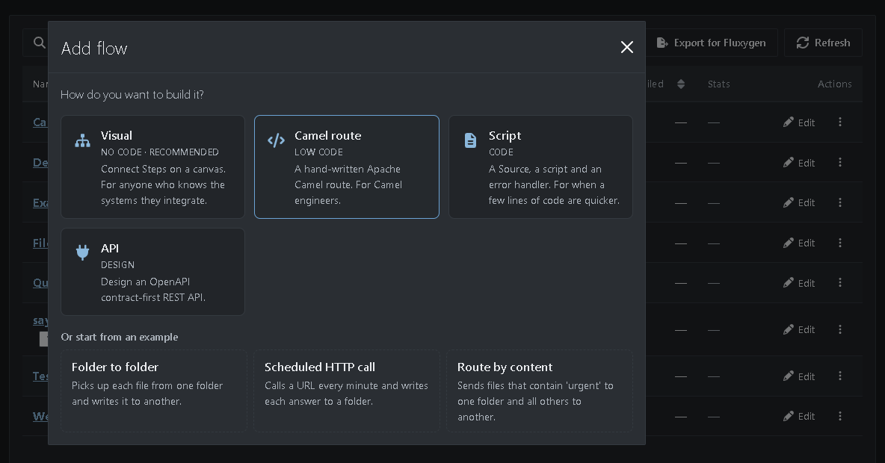
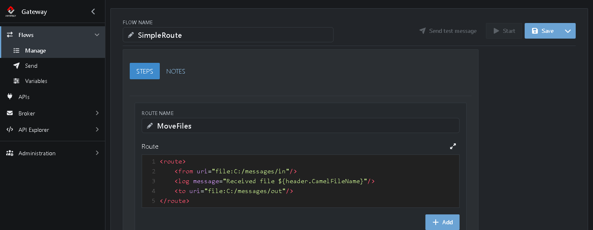
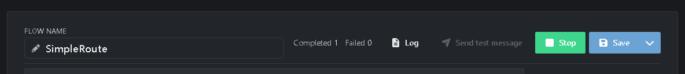
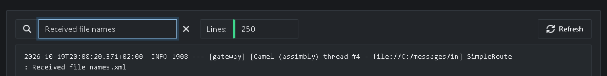

# Tutorial 7: Create a simple route

So far you built every Flow on the visual canvas. Under the hood, the Gateway turns those Flows into [Apache Camel](https://camel.apache.org/) routes. If you already know Camel, you can also write a route yourself. In this tutorial you write your first one.

**What you'll do:**

1. Create a Camel route Flow
2. Write a route in XML
3. Run it and find its log message

It takes about 10 minutes.

## Before you start

* Complete the [Quick start](https://github.com/assimbly/gateway/wiki/quick-start). You need the Gateway running and the folders `C:/messages/in` and `C:/messages/out`.
* Make sure *TestFlow* is stopped (see **Flows → Manage**). Otherwise it picks up the file before your route can.
* You don't need to know Camel to follow along, but it helps. The [Camel routes](https://camel.apache.org/manual/routes.html) page of the Camel manual is a good start.

> On Linux or macOS, use `/home/<you>/messages/...` wherever this tutorial says `C:/messages/...`.

## How it works

A Camel route describes in a few lines where messages come from, what happens to them and where they go. The route you write does the same as *TestFlow*, plus a log message:

```xml
<route>
    <from uri="file:C:/messages/in"/>
    <log message="Received file ${header.CamelFileName}"/>
    <to uri="file:C:/messages/out"/>
</route>
```

| Line | What it does |
|------|--------------|
| `<from uri="file:C:/messages/in"/>` | Picks up files from the `in` folder, like a Source. |
| `<log message="..."/>` | Writes a line to the Gateway log. `${header.CamelFileName}` is replaced by the name of the file. |
| `<to uri="file:C:/messages/out"/>` | Writes the file to the `out` folder, like a Sink. |

The URIs are the same as the **Component** and **Path** you chose in the visual editor: `file` is the component, `C:/messages/in` the path.

## Step 1: Create a Camel route Flow

1. Go to **Flows → Manage** and click **Add**.
2. Choose **Camel route**.



The route editor opens. Instead of a canvas, it has a field to write the route in. It starts with a small example route, which sends `Hello world` once and logs it.

## Step 2: Write the route

1. Next to **Flow name**, type `SimpleRoute`.
2. Set **Route name** to `MoveFiles`.
3. Replace the example in the **Route** field with the route from [How it works](#how-it-works).



4. Click **Save**.

> **Tips**
> * Click the **Edit route** icon above the field to write the route in a full-screen editor.
> * With **Add** you add more routes to the same Flow, for example routes that call each other.
> * Under **Error handler name** you can write a route that handles errors. Leave it empty to use the default error handling.

## Step 3: Run the route

1. Click **Start**.
2. Save the following XML as `names.xml` in the `C:\messages\in` folder:

   ```xml
   <names>
       <name>
          <firstname>John</firstname>
          <lastname>Doe</lastname>
       </name>
       <name>
          <firstname>Michael</firstname>
          <lastname>Kay</lastname>
       </name>
       <name>
          <firstname>Jane</firstname>
          <lastname>Smith</lastname>
       </name>
   </names>
   ```

The route picks up the file and moves it to the `C:\messages\out` folder. The **Completed** counter in the header goes up:



## Step 4: Find the log message

1. Go to **Administration → Log viewer**.
2. Type `Received file names` in the filter box.



There it is: `Received file names.xml`, written by the `<log>` line of your route.

When you're done, stop *SimpleRoute* with **Stop** in its editor.

## Visual Flow or Camel route?

| | Visual Flow | Camel route |
|---|---|---|
| **Build** | Click Steps together on a canvas | Write XML |
| **For** | Anyone who knows the systems they integrate | Camel engineers |
| **Strength** | Quick to build and easy to read | Everything Camel can do, such as splitting, filtering and routing on content |

You can mix them: some Flows visual, others as Camel routes, all running in the same Gateway.

**Done!** You wrote and ran your first Camel route. In the next tutorial you build a bigger route with queues and a split: [Tutorial 8: A route with queues and a split](https://github.com/assimbly/gateway/wiki/tutorial6-routes-with-split).
