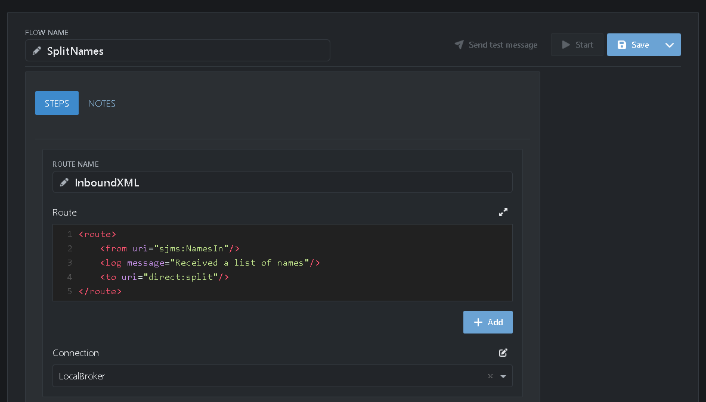
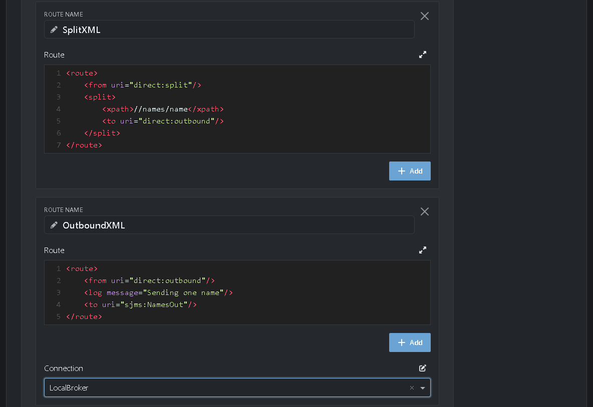
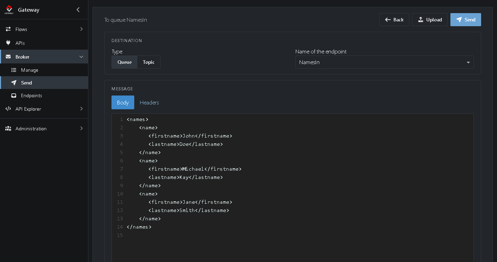
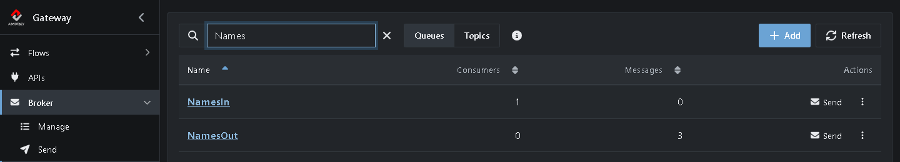
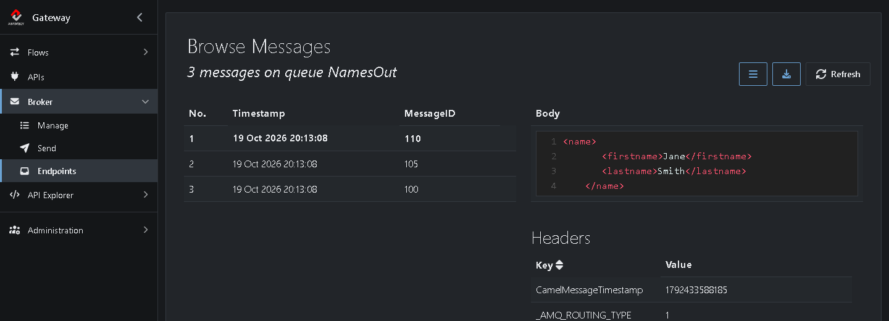

# Tutorial 8: A route with queues and a split

In [Tutorial 7](https://github.com/assimbly/gateway/wiki/tutorial6-simple-route) you wrote a route of a few lines. In this tutorial you combine three routes in one Flow. Together they take a list of names from a queue, split it into one message per name, and put each name on another queue.

**What you'll do:**

1. Create a Camel route Flow
2. Write a route that reads from a queue
3. Write a route that splits the message
4. Write a route that writes to a queue
5. Send a list of names and see it split

It takes about 15 minutes.

## Before you start

* Complete [Tutorial 6](https://github.com/assimbly/gateway/wiki/tutorial6-message-queueing). You need the running broker and the connection *LocalBroker* that you created there.
* Complete [Tutorial 7](https://github.com/assimbly/gateway/wiki/tutorial6-simple-route), so you know the route editor.

## How it works

The Flow *SplitNames* has three routes. They pass messages to each other with `direct:` endpoints, which connect routes within the same Gateway:

**InboundXML:** queue *NamesIn* → `direct:split`

**SplitXML:** `direct:split` → split into one message per `<name>` → `direct:outbound`

**OutboundXML:** `direct:outbound` → queue *NamesOut*

You could write it all in one route. Splitting it up keeps each route small, and you can reuse a route, such as *SplitXML*, from other routes.

## Step 1: Create the Flow

1. Go to **Flows → Manage**, click **Add** and choose **Camel route**.
2. Next to **Flow name**, type `SplitNames`.
3. Set **Route name** to `InboundXML`.
4. Click **Add** under the route field and choose **Connection**. A **Connection** field appears.
5. In **Connection**, choose `LocalBroker`.

> The JMS endpoints of a route (`sjms:`, `sjms2:`, `jms:` and `activemq:`) use the connection you choose here. Only when an endpoint needs another connection, you name that one in the URI yourself, with `connectionFactory=#<id>`. You find a connection's id with the **Edit connection** icon above the **Connection** field.

## Step 2: Write the inbound route

Replace the example route in the **Route** field of *InboundXML* with this route:

```xml
<route>
    <from uri="sjms:NamesIn"/>
    <log message="Received a list of names"/>
    <to uri="direct:split"/>
</route>
```



It takes each message from the queue *NamesIn* and passes it on to `direct:split`.

## Step 3: Write the split route

1. Click **Add** under the route field and choose **Route**. A new, empty route appears.
2. Set **Route name** to `SplitXML` and copy this route into its **Route** field:

```xml
<route>
    <from uri="direct:split"/>
    <split>
        <xpath>//names/name</xpath>
        <to uri="direct:outbound"/>
    </split>
</route>
```

The `<split>` uses the [XPath](https://camel.apache.org/components/latest/languages/xpath-language.html) expression `//names/name` to find every `<name>` element in the message. Each one becomes a message of its own and goes to `direct:outbound`.

## Step 4: Write the outbound route

1. Under *SplitXML*, click **Add** and choose **Route**.
2. Set **Route name** to `OutboundXML` and copy this route into its **Route** field:

```xml
<route>
    <from uri="direct:outbound"/>
    <log message="Sending one name"/>
    <to uri="sjms:NamesOut"/>
</route>
```

3. Under *OutboundXML*, click **Add**, choose **Connection** and select `LocalBroker`. Each route uses its own connection, so this route needs one too.



4. Click **Save**, then **Start**.

You don't need to create the queues *NamesIn* and *NamesOut*: the broker creates them the first time a route uses them.

## Step 5: Send a list of names

1. Go to **Broker → Endpoints**. You see *NamesIn* with 1 consumer: your *InboundXML* route. (Don't see it? The filter box keeps what you typed last time, such as `Orders` from Tutorial 6. Clear it with **×**.)
2. Click **Send** in the row of *NamesIn*.
3. Paste this XML into the **Body**:

   ```xml
   <names>
       <name>
          <firstname>John</firstname>
          <lastname>Doe</lastname>
       </name>
       <name>
          <firstname>Michael</firstname>
          <lastname>Kay</lastname>
       </name>
       <name>
          <firstname>Jane</firstname>
          <lastname>Smith</lastname>
       </name>
   </names>
   ```



4. Click **Send**.

## Step 6: See the result

1. Go to **Broker → Endpoints** and type `Names` in the filter box.



The one message you sent to *NamesIn* is gone. *NamesOut* has 3 messages: one per name.

2. Click **NamesOut** to browse them. Each message holds one `<name>`:



When you're done, stop *SplitNames* with **Stop** in its editor. To remove the test messages, use **⋮** → **Clear** on *NamesOut*.

## Summary

| Route | Reads from | Does | Writes to |
|-------|-----------|------|-----------|
| *InboundXML* | queue *NamesIn* | Logs a line | `direct:split` |
| *SplitXML* | `direct:split` | Splits on `//names/name` | `direct:outbound`, once per name |
| *OutboundXML* | `direct:outbound` | Logs a line | queue *NamesOut* |

**Done!** You built a Flow of three routes with queues and a split. Continue with [Tutorial 9: Running scripts](https://github.com/assimbly/gateway/wiki/tutorial6-running-scripts).
