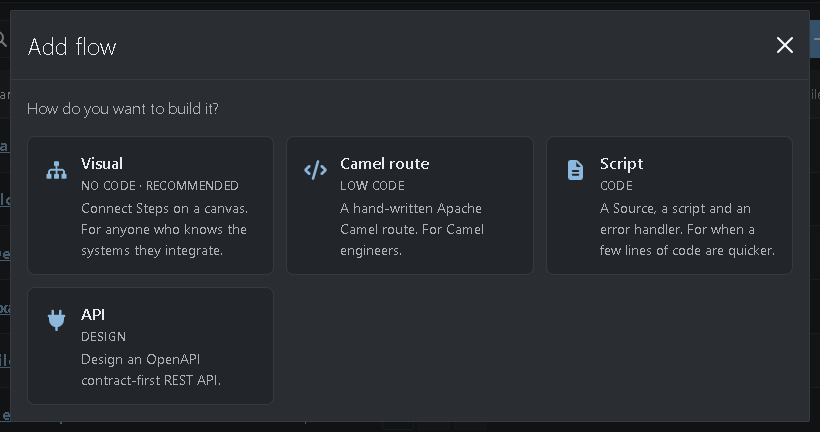
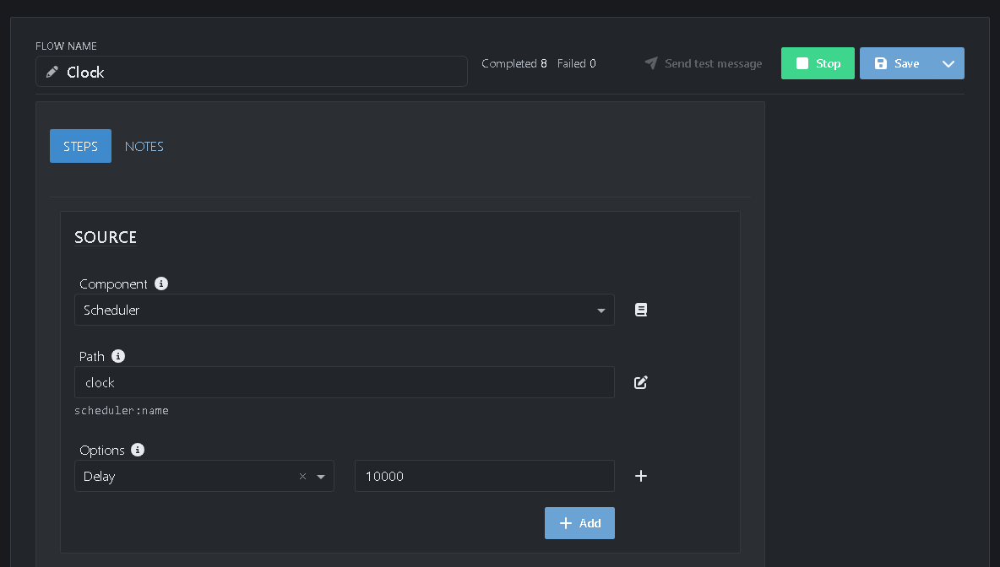
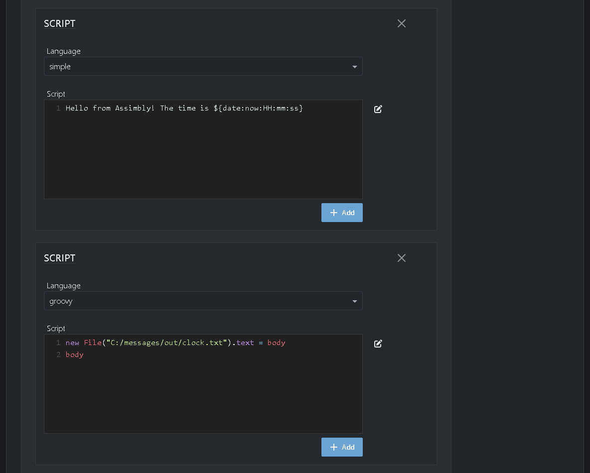
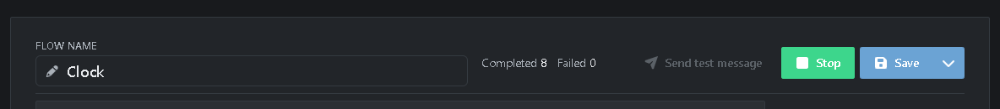

# Tutorial 9: Running scripts

Sometimes a few lines of code are quicker than a Flow of Steps. A **Script** Flow runs your own script: in Camel's Simple language, Groovy, JavaScript, JSLT or XSLT. In this tutorial you build a small clock: every 10 seconds one script writes a greeting with the current time, and a second script saves it to a file.

**What you'll do:**

1. Create a Script Flow
2. Set the Source that triggers the scripts
3. Write a script in Simple
4. Add a script in Groovy
5. Start the Flow and read the result

It takes about 10 minutes.

## Before you start

* Complete the [Quick start](https://github.com/assimbly/gateway/wiki/quick-start). You need the Gateway running and the folder `C:/messages/out`.

> On Linux or macOS, use `/home/<you>/messages/...` wherever this tutorial says `C:/messages/...`.

## How it works

A Script Flow has three parts:

| Part | What it does |
|------|--------------|
| **Source** | Starts the Flow, like in a visual Flow. A new Script Flow starts with a **Scheduler**. |
| **Script** | Runs your script. The result of the script becomes the message. Add more Scripts to run them one after another: each Script gets the message the one before it made. |
| **Error handler** | Takes care of a message when a script fails. By default it writes the error to the Gateway log. |

A Script Flow has no Sink. When the last script is done, the message is done. To send the result somewhere, the script does it itself, as the second script in this tutorial does.

The Flow you build looks like this:

**Scheduler (Source)** → **Simple (Script)** → **Groovy (Script)**

## Step 1: Create a Script Flow

1. Go to **Flows → Manage** and click **Add**.
2. Choose **Script**.



The script editor opens. Like the route editor of [Tutorial 7](https://github.com/assimbly/gateway/wiki/tutorial6-simple-route), it has a form instead of a canvas.

## Step 2: Set the Source

1. Next to **Flow name**, type `Clock`.
2. Under **Source**, keep **Component** on **Scheduler**.
3. Set **Path** to `clock`. This is just a name for the scheduler.
4. Under **Options**, choose **Delay** in the list and type `10000`.



The delay is in milliseconds, so the scripts run once every 10 seconds. You know the Scheduler from [Tutorial 3](https://github.com/assimbly/gateway/wiki/tutorial6-calling-a-rest-api).

## Step 3: Write a script in Simple

1. Under **Script**, set **Language** to `simple`.
2. Type this in the **Script** field:

   ```
   Hello from Assimbly! The time is ${date:now:HH:mm:ss}
   ```

[Simple](https://camel.apache.org/components/latest/languages/simple-language.html) is Camel's own small expression language. The text is copied as it is, and every `${...}` is replaced: `${date:now:HH:mm:ss}` by the current time. The result, for example `Hello from Assimbly! The time is 14:05:10`, becomes the message.

## Step 4: Add a script in Groovy

1. Click **Add** under the script and choose **Script**. A second **Script** appears.
2. Set its **Language** to `groovy`.
3. Type this in its **Script** field:

   ```groovy
   new File("C:/messages/out/clock.txt").text = body
   body
   ```



[Groovy](https://groovy-lang.org/) is a programming language for the Java platform. In a script, `body` is the message: the greeting the Simple script made. The first line writes it to the file `clock.txt`. The second line, `body`, is the result of the script, so the message stays the same.

4. Click **Save**.

> **Which language?** Use **simple** to build text from the message and its headers, **groovy** or **javascript** when you need real code, **jslt** to transform JSON and **xslt** to transform XML.

## Step 5: Start the Flow and read the result

1. Click **Start**.

The first run starts a second after you start the Flow. After that, the **Completed** counter goes up every 10 seconds:



2. Open `clock.txt` in the `C:\messages\out` folder:

   ```
   Hello from Assimbly! The time is 14:05:10
   ```

Open it again a little later: the time has changed.

**Try it yourself:**

* Add the date: change the Simple script to `Hello from Assimbly! It is ${date:now:yyyy-MM-dd HH:mm:ss}`. Save the Flow, then click **Stop** and **Start** to run it with the new script.
* Break the Groovy script on purpose, for example by writing to a folder that doesn't exist. The **Failed** counter goes up and an **Alert** badge appears. See [Tutorial 1](https://github.com/assimbly/gateway/wiki/tutorial6-debugging-a-flow) for finding the error.

When you're done, click **Stop**. Otherwise the Flow keeps writing the file every 10 seconds.

## Summary

| Step | Language | What it does |
|------|----------|--------------|
| Source | **Scheduler** | Starts the Flow every 10 seconds (**Delay** `10000`). |
| Script | **simple** | Makes the greeting with the current time. The result becomes the message. |
| Script | **groovy** | Writes the message (`body`) to `clock.txt` and keeps it as the result. |

**Done!** You ran your first scripts. In the last tutorial you control the Gateway without the browser: [Tutorial 10: Using the API](https://github.com/assimbly/gateway/wiki/tutorial6-using-the-api).
